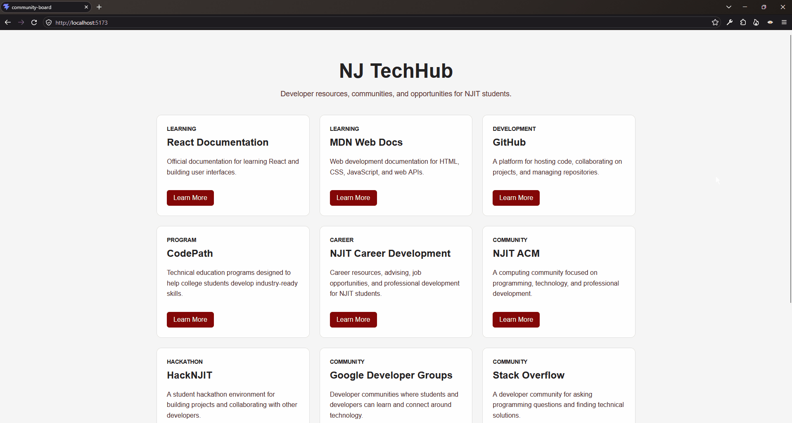
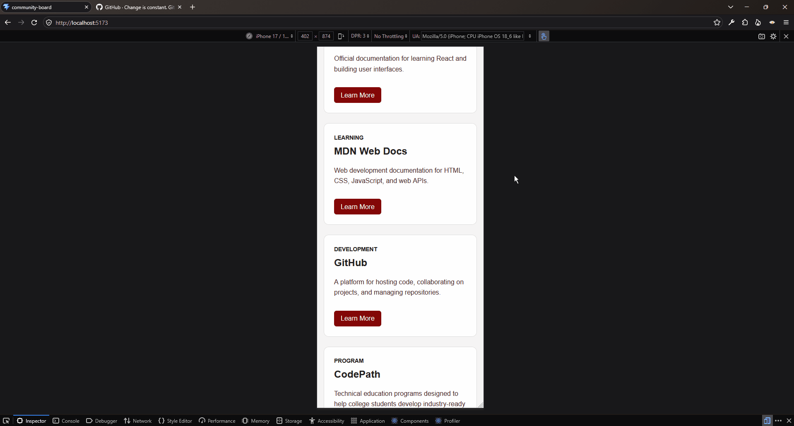

# Web Development Project 1 - *NJTechHub*

Submitted by: **Scarlet Ceballos**

This web app: **A community resource board designed for NJIT students interested in technology, software development, and career development. Contains a collection of developer reousrces, communities, programs, and career opportunities all in one page in an organized card layout.**

Time spent: **5** hours spent in total

## Required Features

The following **required** functionality is completed:

- [x] **The app has a cohesive, unique theme for events or resources relevant to a specific community**
  - [x] Header/title describing the theme is displayed
- [x] **At least 10 unique events or resources are displayed in a responsive card format**
  - [x] There are at least 10 cards displayed for 10 different events 
  - [x] The cards should be displayed in an organized format (ex. a grid, or in one line)
  - [x] Each card should include some information about the event or resource

The following **optional** features are implemented:

- [x] Buttons or links to a related resources are on each card component
  - [x] All cards have buttons or links in addition to text
- [x] The site is responsive for both desktop and mobile formats
  - [x] Web app is shown in a mobile format
  - [x] **Video Walkthrough Special Instructions**: To ease the grading process, please use Chrome Developer Tools' "Toggle Device" button to demonstrate that your web application's responsiveness in both a desktop *and* a mobile format. Detailed instructions can be found below this stretch feature on the project page. 

The following **additional** features are implemented:

- [x] Resource links open in a new tab
- [x] Card hover effects have visual feedback
- [x] Resource categories displayed on each card

## Video Walkthrough

Here's a walkthrough of implemented required features:

<!-- Replace this with whatever GIF tool you used! -->
GIF created with [N-Studio](https://nicke.tech/n-studio)

## Notes

One challenge I took some time to learn was making the card layout responsive. I used the CSS grid for the desktop layout and a media query to change the card to a single-column layout on mobile screens.

## License

    Copyright [2026] [Scarlet Ceballos]

    Licensed under the Apache License, Version 2.0 (the "License");
    you may not use this file except in compliance with the License.
    You may obtain a copy of the License at

        http://www.apache.org/licenses/LICENSE-2.0

    Unless required by applicable law or agreed to in writing, software
    distributed under the License is distributed on an "AS IS" BASIS,
    WITHOUT WARRANTIES OR CONDITIONS OF ANY KIND, either express or implied.
    See the License for the specific language governing permissions and
    limitations under the License.
